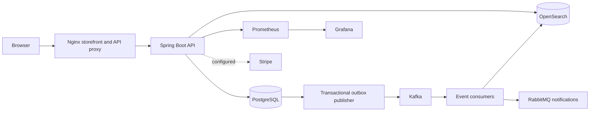

# Nothing Market

**An event-driven, multi-vendor e-commerce platform built with Java and Spring Boot.**


Nothing Market combines a responsive storefront, seller and administrator workflows, transactional commerce, asynchronous events and searchable inventory in a single repository. The project is under active development; public production readiness has not yet been verified.

## Features

| Customer | Seller | Administrator |
| --- | --- | --- |
| Account registration and sign-in | Seller application | Seller and listing approval |
| Fuzzy search and dynamic filters | Product listings and images | Catalog quality review |
| Dedicated product pages and related products | Inventory and pricing | Promotions and retailer approval |
| Wishlist, reviews and persistent cart | Postal delivery coverage | Platform delivery zones |
| COD and configurable Stripe checkout | Order fulfillment | Order tracking and oversight |

Product pages use shareable hash URLs (`/#product/170`, for example). Delivery estimates are seller-configured, not live courier guarantees. Demo catalog photographs and prices are illustrative.

## Architecture



PostgreSQL is the authoritative store for commerce data. Kafka distributes committed changes; OpenSearch provides a derived search index. RabbitMQ supports asynchronous notification processing. This is a modular application with supporting distributed services, not a collection of independently deployed commerce microservices.

## Technology stack

| Layer | Technology |
| --- | --- |
| Backend | Java 21, Spring Boot 3.2.5, Maven, Spring Security, JPA |
| Frontend | HTML, CSS, JavaScript, Nginx |
| Persistence | PostgreSQL, Flyway |
| Messaging | Apache Kafka, RabbitMQ |
| Search | OpenSearch |
| Payments | COD, Stripe |
| Observability | Actuator, Micrometer, Prometheus, Grafana |
| Infrastructure | Docker Compose, GitHub Actions, Terraform examples |

## Local development

Prerequisites: Git, Docker with Compose v2; Java 21 for running Maven outside Docker.

```powershell
git clone https://github.com/someshhh-45/Nothing_Store.git
cd Nothing_Store
Copy-Item backend/.env.example backend/.env
notepad backend/.env
docker compose -f backend/compose.yml --env-file backend/.env up -d --build
docker compose -f backend/compose.yml --env-file backend/.env ps
```

Configure private database and broker passwords, JWT secret and optional integrations before startup. On Linux/macOS use `cp backend/.env.example backend/.env` instead of Copy-Item.

| Service | Default local URL |
| --- | --- |
| Storefront | http://localhost:8000 |
| Backend | http://localhost:8090 |
| Metrics | http://localhost:8091 |
| Prometheus | http://localhost:9090 |
| Grafana | http://localhost:3000 |

Ports depend on the selected Compose profile and environment configuration. Never commit private environment files or delete database volumes to troubleshoot startup.

## Repository structure

```text
Nothing_Store/
├── backend/             Spring Boot application, migrations and tests
│   ├── src/
│   ├── infrastructure/ Monitoring and Terraform
│   └── compose*.yml     Local, managed-service and HA profiles
├── nothing-coffee/      Storefront assets, scripts and styles
├── docs/                Architecture and operational documentation
├── scripts/             Smoke, repair and load-testing utilities
├── tests/               Storefront regression tests
├── .github/workflows/   Continuous integration
├── Dockerfile           Hosted container build
└── render.yaml          Render deployment definition
```

## Documentation

| Guide | Contents |
| --- | --- |
| [Architecture and workflows](docs/ARCHITECTURE.md) | Data ownership, events, checkout, delivery, search |
| [Development and deployment](docs/DEVELOPMENT_AND_DEPLOYMENT.md) | Setup, tests, release checklist |
| [Backend administration](backend/README.md) | Database access and diagnostics |
| [Marketplace features](docs/AUTH_AND_MARKETPLACE_FEATURES.md) | Authentication and marketplace workflows |
| [Marketplace offers](docs/MARKETPLACE_OFFERS.md) | Catalog and seller offers |
| [Email confirmation](docs/ORDER_CONFIRMATION_EMAIL.md) | Notification configuration |
| [Reliability and load](docs/RELIABILITY_LOAD_AIVEN.md) | Managed services and reliability |
| [HA deployment](docs/ROUND_ROBIN_DEPLOYMENT.md) | Round-robin infrastructure |
| [Historical setup notes](docs/LEGACY_README.md) | Archived previous README; may contain obsolete branches and instructions |

## Release status

- Implemented in source: marketplace, search, delivery coverage, product detail pages and related products.
- Pending verification: current browser regression suite, strict delivery configuration, payment reconciliation, notification delivery and hosted end-to-end operation.
- Before accepting real orders: verify merchant data, product images, policies, tax requirements, security, backups and operational monitoring.

Use test credentials and synthetic data during development. Do not expose database administration, monitoring endpoints or secrets publicly.
