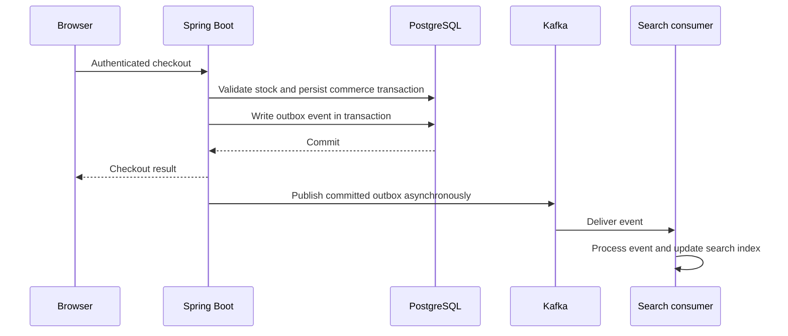

# Architecture and workflows

[Back to project README](../README.md)

## Design principles

- PostgreSQL owns transactional state; search indexes and messages are derived from committed state.
- Server-side authorization, stock and pricing checks take precedence over browser values.
- Seller offers retain distinct stock-bearing product IDs through checkout.
- External integrations are configuration-dependent and require live verification.

## Application layers

The Java application currently uses controller, service, repository, model, configuration and extension packages under `backend/src/main/java/com/eshop/Ecommerce/`. The storefront is in `nothing-coffee/`. This documents the existing structure rather than proposing an unperformed package refactor.

## Data model overview

| Domain | Representative tables |
| --- | --- |
| Identity | users, pending_signups, email_verification_challenges |
| Catalog | products, category, marketplace_offers |
| Shopping | carts, cart_item, customer_wishlist, address |
| Commerce | orders, order_items, payments |
| Fulfillment | order_tracking_events, after_sale_requests |
| Messaging | nothing_outbox, nothing_consumed, order_confirmation_emails |

Delivery coverage is defined by `V11__delivery_coverage.sql`. Flyway migrations V1–V11 cover outbox, retries, marketplace offers, email confirmation, seller workflows, catalog matching, fulfillment, quality reviews, corrections, identity audit and delivery coverage. This is a logical overview, not a complete physical schema or exhaustive foreign-key reference.

## Checkout and event flow

COD and Stripe have different payment lifecycles. A signed Stripe webhook, not a browser redirect, establishes payment confirmation. Consumer idempotency and outbox retry mechanisms are present; failure recovery and reconciliation still require deployment testing.

## Delivery coverage

Sellers configure enabled PIN ranges and estimated minimum/maximum delivery days. Platform-owned inventory uses administrator-managed coverage. A six-digit Indian PIN is checked against the selected stock-bearing product's seller.

| Status | Meaning |
| --- | --- |
| SERVICEABLE | Matching enabled range; configured delivery estimate |
| UNAVAILABLE | No matching enabled range, or all configured ranges disabled |
| UNVERIFIED | No coverage configured |

The service defaults to `nothing.delivery.require-configured=false`; unconfigured coverage may therefore allow checkout. Configure zones and validate strict mode before public release.

## Selected API routes

| Method and route | Purpose |
| --- | --- |
| GET /api/store/catalog | Live catalog |
| GET /api/search/products | Search and filters |
| GET /api/store/recommendations | Related product candidates |
| GET /api/store/products/{productId}/reviews | Product feedback |
| GET /api/store/delivery/check | Product and PIN coverage |
| GET /api/customer/delivery/cart | Address-based cart coverage |
| GET, POST /api/seller/delivery/zones | Seller coverage management |
| GET, POST /api/admin/delivery/zones | Platform coverage management |
| GET /api/customer/orders | Customer order history |

This is a selected route reference, not a complete API contract. Consult controllers for request fields, permissions and response schemas.

## Storefront

Dedicated hash-routed product pages reuse the catalog, seller selection, delivery check, wishlist, reviews and checkout. Related results exclude the current catalog group, duplicates, out-of-stock products and other categories. Buy Now currently uses the cart checkout flow. Multiple-image galleries, structured specifications and purchase-based recommendations remain future enhancements.
